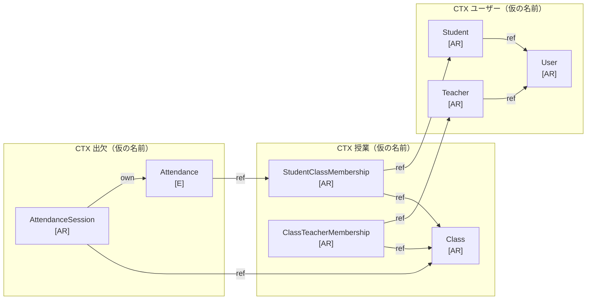
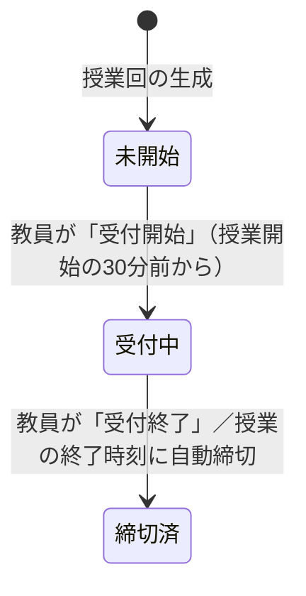

# ドメインモデル

出典: ユーザーが示した図（[ENG-006](../decisions.md)）。業務のルールは [基本設計書](../basic-design.md) 1・6・8・10章。テーブル・項目の定義は [db-schema.md](db-schema.md)。

## 図

記号: `CTX`＝コンテキスト（まとまり）、`AR`＝集約ルート、`E`＝エンティティ（集約の中にある）、`own`＝集約がエンティティを持つ、`ref`＝他の集約を参照する。



- 元の図は画像なので、同じ内容を mermaid で書き写した。
- 3つの CTX の名前は、元の図では未記入。ここでは含まれるものから「ユーザー」「授業」「出欠」と仮に呼ぶ。決まったら書き換える。
- 元の図の「Classs」は Class の誤記と読んだ。

## 概念と提出版の対応

| ドメインモデル | 種別 | 意味 | 提出版（基本設計書）の対応 |
|---|---|---|---|
| User | AR | サインインするユーザー。ログインIDは Microsoft のメールアドレス（ENG-003） | なし（新規） |
| Student | AR | 学生。User を参照する | student_mst |
| Teacher | AR | 教員。User を参照する | teacher_mst |
| Class | AR | 授業（科目名・教室・1回あたりの時間数・欠課上限）。曜日・時限・期間は授業回を作るときの入力で、授業には持たない（ENG-008） | course_mst |
| StudentClassMembership | AR | 学生がその授業を受講していること。Student と Class を参照する | enrollment_mst |
| ClassTeacherMembership | AR | 教員がその授業を担当していること。Teacher と Class を参照する | なし（新規）。提出版は course_mst.teacher_id で担当教員は1人 |
| AttendanceSession | AR | 授業1回分の出欠の受付。Class を参照し、Attendance を持つ | class_session_trn（授業回）。受付状態もここにある |
| Attendance | E | 1人分の出欠。AttendanceSession が持ち、StudentClassMembership を参照する | attendance_trn |

## 提出版との違い

提出版にない、または違う点（[ENG-006](../decisions.md)）。

1. **User がある。** Student と Teacher は User を参照する。提出版は、student_mst / teacher_mst がメールアドレスを持ち、サインインしたメールアドレスで照合していた。
2. **授業と教員は多対多。** ClassTeacherMembership で結ぶ。提出版は授業に担当教員が1人（course_mst.teacher_id）。「担当授業」は、ClassTeacherMembership に自分がいる授業のこと。
3. **出欠は学生ではなく受講を参照する。** Attendance は StudentClassMembership を参照する（提出版は student_id を直接持つ）。授業を受講していない学生の出欠は作れない、という関係がモデルで表される。
4. **出欠は AttendanceSession が持つ。** 出欠の登録・修正は、授業回の集約（AttendanceSession）を通して行う。受付状態や二重申告のチェックを、この集約の中で守る。

## 図にないもの

提出版にあって、図に描かれていないもの。図には足さず、提出版の関係のまま扱う（[ENG-007](../decisions.md)）。

| 提出版 | 提出版での関係 |
|---|---|
| 学生証（student_card_mst） | 学生に紐づく。再発行で古いものを無効にする |
| 時限（period_mst） | 授業が参照する |
| 出欠修正履歴（attendance_history_trn） | 出欠に紐づく。修正した教員も持つ |
| タッチログ（card_touch_log_trn） | 授業回に紐づく。エラーも含めて全件残す |
| 欠課時数の集計 | DBには作らず、backend が出欠から計算する（[db-schema.md](db-schema.md)） |

## 用語

| 用語 | 意味 |
|---|---|
| 授業（Class） | 科目名・教室・1回あたりの時間数・欠課上限を持つ開講単位。担当教員は ClassTeacherMembership で結ぶ |
| 授業回（AttendanceSession） | ある日のある授業1回。出欠は授業回ごとに記録する。授業登録時に期間と曜日から自動生成し、休講・補講・時間変更を編集できる |
| 受講（StudentClassMembership） | 授業と学生の組 |
| 担当（ClassTeacherMembership） | 授業と教員の組。1つの授業に複数の教員がいてよい |
| 出欠（Attendance） | 授業回 × 学生で1件の記録。出席・遅刻・早退・欠課・公欠のどれか |
| 申告 | 学生が学生証をカードリーダーにかざして出席を伝えること。申告した時刻はサーバ時刻 |
| 受付 | 授業回で申告を受け付けている状態。教員が開始し、教員の操作か授業の終了時刻で締め切る |
| 欠課時数 | 出欠から計算する数値。**保存しない**（下の「欠課時数」参照） |
| 欠課上限 | 授業ごとに設定する、欠課時数の上限（`absence_limit_hours`） |
| 学生証 | カードIDで識別する。再発行すると古い学生証は無効になる |
| ロール | 学生（ROLE0001）と教員（ROLE0002）の2つ。サインインしたユーザープール（学生用／教員用）で決まる（ENG-004） |

## 状態

### 受付状態（授業回ごと）



- 締切時に、出欠の記録がない受講学生を欠課（入力区分＝自動）で登録する。
- **受付を一度も開始しなかった授業回は、自動で欠課にしない。** 教員ホームに「未実施」と表示する（提出版の仮の決め）。
- 授業回区分が休講（9）の授業回は、出欠を記録しない。

### 学生証

- 有効（valid_flg=1）／無効（valid_flg=0）。再発行時に古い学生証を無効にし、`invalid_datetime` を記録する。
- 有効な card_uid は一意。別の学生に登録済みの学生証は登録できない（`A_S0005_E000001`）。

## ルール

### 出欠の判定（かざした時刻はサーバ時刻）

| かざした時刻 | 判定 |
|---|---|
| 授業開始時刻まで | 出席 |
| 開始時刻を過ぎ、開始後15分00秒まで | 遅刻 |
| 開始後15分より後 | 欠課 |
| 授業終了まで申告なし | 欠課（締切時に自動で登録） |

教室PCの時計がずれていても、判定の境目は変わらない。

### 欠課時数

```
欠課時数     ＝ 欠課回数 × 1回あたりの時間数 ＋ 遅刻回数を3で割った商
上限までの残り ＝ 欠課上限時間 － 欠課時数
```

- 1回あたりの時間数は授業ごとに設定。初期値は2（90分の授業を2時間と数える想定）。
- 遅刻は同じ授業で3回で欠課1時間。
- 公欠は数えない。早退は区分だけ用意し、換算しない（未決。[decisions.md](../decisions.md) #2）。

### 申告（学生証をかざしたとき）

サーバが次の順に確かめ、1つでも外れたらエラーを返す。すべてのタッチは結果にかかわらずタッチログに残す。

| 順 | 確認 | 外れたとき | タッチ結果区分 |
|---|---|---|---|
| 1 | 受付中の授業回（AttendanceSession）か | 受付が終了しています（`A_S0001_E000003`） | 9 締切後 |
| 2 | 有効な学生証として登録されているか | 登録されていない学生証です（`A_S0001_E000001`） | 8 未登録 |
| 3 | その授業の受講（StudentClassMembership）があるか | この授業の受講学生ではありません（`A_S0001_E000002`） | 7 受講対象外 |
| 4 | すでに申告済みか | 申告済み。記録は変えない（`A_S0001_I000002`） | 2 申告済み |
| 5 | 上の判定ルールで判定して登録 | — | 1 受付 |

- 読み取りに失敗したとき（`A_S0001_W000001`）は、受付アプリが「もう一度かざしてください」を表示する。サーバには送られない。
- 申告は受付アプリだけから受け付ける（授業回ごとの受付トークン。受付開始で発行し、締切で失効）。

### 出欠の修正

- 教員だけが、担当授業の出欠を修正できる。学生はできない（R-04-3）。
- 修正理由が必須（`A_S0004_E000001`）。変更前後・理由・修正した教員・日時を `attendance_history_trn` に残す。
- 楽観的排他。他の人が先に更新していたら失敗する（`A_S0004_E000002`）。

### 権限

「担当授業」は、ClassTeacherMembership に自分がいる授業。

| 画面・操作 | 学生 | 教員 |
|---|---|---|
| 自分の出欠記録・欠課時数を見る | 自分の記録のみ | 不可 |
| 出欠一覧・欠課時数一覧・書き出し | 不可 | 担当授業のみ |
| 出欠修正 | 不可 | 担当授業のみ |
| 授業・授業回・受講学生の登録 | 不可 | 自分の授業のみ |
| 学生・学生証の登録 | 不可 | 可 |
| 受付の開始・終了 | 不可 | 担当授業のみ |
| 学生証をかざす | 可 | — |

- ロール判定: サインインしたユーザープール（学生用か教員用か）で決まる（ENG-004。提出版は、メールアドレスが `student_mst` / `teacher_mst` のどちらにあるかで判定）。ログインID（Microsoft のメールアドレス）から User、その Student / Teacher を引き、見つからなければ `SYSCOMMON_E000101` を表示する。
- 誰のデータを見せるかは、画面から送られたIDではなく、サーバが認証トークンから決める。
